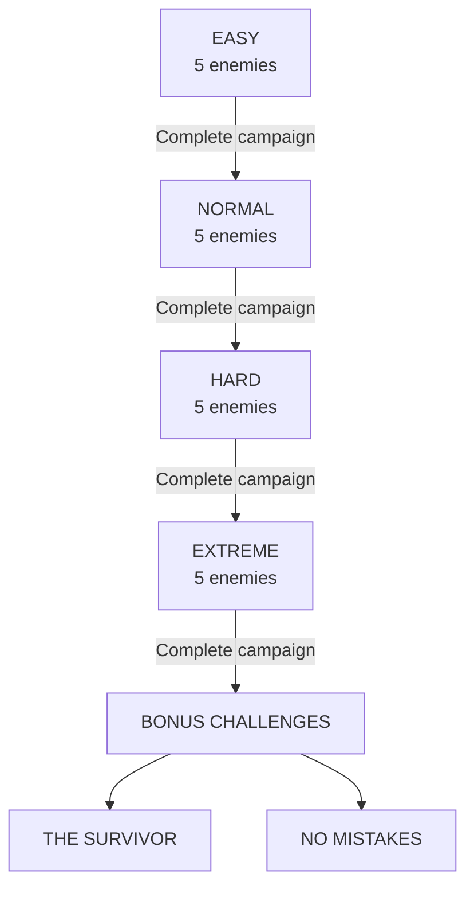
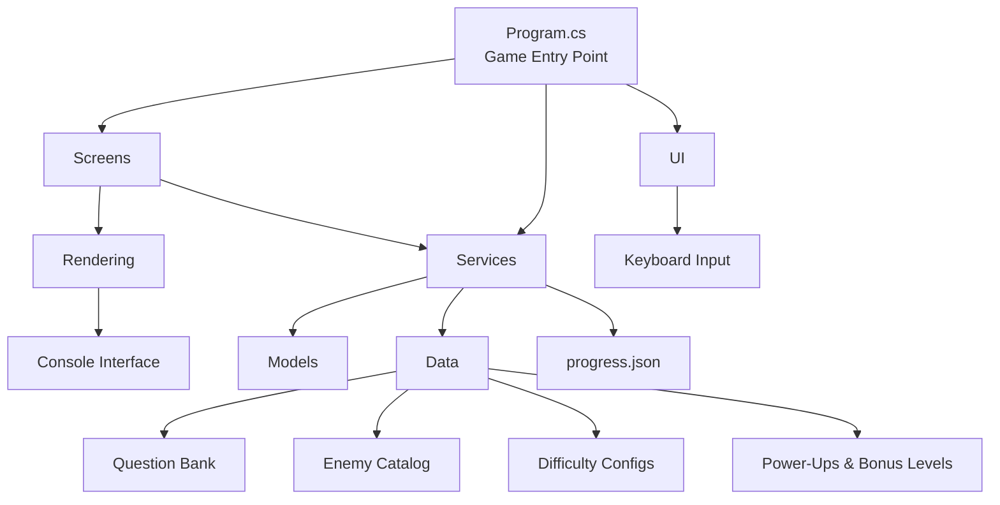

 <div align="center">


<br/>

# CODE QUEST

### Fight bugs. Defeat malware. Master the code.

A terminal-based RPG where computer science knowledge becomes your weapon.

Answer technical questions, defeat digital enemies, earn XP, unlock new difficulties and face the ultimate boss: **The Architect**.

<br/>

[](https://github.com/RufusTheDwarf/Code_Quest)
[](https://dotnet.microsoft.com/)
[](https://learn.microsoft.com/en-us/dotnet/csharp/)
[](https://www.microsoft.com/windows)
[](#)
[](LICENSE)

<br/>

[](https://github.com/RufusTheDwarf/Code_Quest/stargazers)
[](https://github.com/RufusTheDwarf/Code_Quest/forks)
[](https://github.com/RufusTheDwarf/Code_Quest/issues)
[](https://github.com/RufusTheDwarf/Code_Quest/commits/main)

<br/>

**[PLAY THE GAME](https://github.com/RufusTheDwarf/Code_Quest/releases/latest)** · **[EXPLORE THE SOURCE](https://github.com/RufusTheDwarf/Code_Quest)** · **[REPORT A BUG](https://github.com/RufusTheDwarf/Code_Quest/issues)**

</div>

---

## Enter the Digital Battlefield

Code Quest transforms computer science questions into RPG combat.

You play as a developer fighting against increasingly dangerous threats from the digital world. Every enemy represents a technical concept, a programming error or a cybersecurity threat.

Your knowledge determines whether you survive.

The game combines:

- RPG-style combat and enemy encounters
- Multiple-choice technical questions
- XP, levels and health progression
- Four difficulty tiers
- Unlockable bonus challenges
- ASCII enemy sprites and a custom terminal interface
- Persistent difficulty progression

**This is not just a quiz. It is a small RPG built around learning computer science.**

## Visual Atmosphere

The visual direction takes inspiration from dark developer workspaces, retro terminals and cyberpunk interfaces.

<div align="center">


<sub>Illustrative atmosphere image, not an actual gameplay screenshot.</sub>

<br/><br/>


<sub>Terminal-inspired visual reference.</sub>

</div>

## The Game at a Glance

<div align="center">

<table>
<tr>
<td align="center" width="25%">
<h2>65</h2>
<sub>QUESTIONS</sub>
</td>
<td align="center" width="25%">
<h2>20</h2>
<sub>ENEMIES</sub>
</td>
<td align="center" width="25%">
<h2>4</h2>
<sub>DIFFICULTIES</sub>
</td>
<td align="center" width="25%">
<h2>2</h2>
<sub>BONUS MODES</sub>
</td>
</tr>
</table>

</div>

## The Four Difficulty Tiers

Your campaign becomes progressively harder. Each difficulty introduces new enemies and a larger question pool.

<div align="center">


</div>

### 01. Easy

<badge color="success">INITIATION</badge>

*Your first expedition into the world of computer science.*

| Enemies | Role |
|:--|:--|
| BUG | A small programming error |
| TYPO | A typo that breaks everything |
| NULL POINTER | A reference to nothing |
| SYNTAX ERROR | A missing piece of syntax |
| MINI-BUG | First boss encounter |

### 02. Normal

<badge color="warning">INTERMEDIATE</badge>

*The technical threats become more serious.*

| Enemies | Role |
|:--|:--|
| MALWARE | A malicious program |
| RANSOMWARE | A threat that encrypts everything |
| HACKER | An attacker searching for vulnerabilities |
| STACK ERROR | A stack overflow |
| MEMORY LEAK | A boss that consumes your memory |

### 03. Hard

<badge color="danger">EXPERT</badge>

*The core of the system. Few make it through.*

| Enemies | Role |
|:--|:--|
| SEGFAULT | Invalid memory access |
| INJECTION SQL | An attack against database queries |
| DEADLOCK | Processes waiting for each other |
| KERNEL PANIC | A fatal system failure |
| THE COMPILER | The final boss of the hard campaign |

### 04. Extreme

<badge color="discovery">NIGHTMARE</badge>

*Beyond the code. Pure chaos.*

| Enemies | Role |
|:--|:--|
| ROOTKIT | Hidden deep inside the system |
| ZERO-DAY | An unknown vulnerability |
| BLACK ICE | A dangerous digital defence |
| QUANTUM BREACH | An unpredictable threat |
| THE ARCHITECT | The final boss with three phases |

The difficulty progression is sequential:



## Combat System

Each encounter is based on a computer science question.

A correct answer damages the enemy. A wrong answer costs you health.

### Combat Rules

| Event | Effect |
|:--|:--|
| Correct answer | Enemy loses 1 HP |
| Wrong answer | Player loses 1 HP |
| Defeat an enemy | +20 XP |
| Reach 40 XP | Level up |
| Level up | Maximum HP increases by 1 |
| Shield active | Absorbs the next incorrect answer |
| Damage boost active | Correct answers deal 2 damage |

You start with 5 HP. Your objective is to defeat all five enemies in your selected difficulty.

### The Combat Interface

The game renders a terminal-based interface with:

- Large ASCII enemy sprites
- Enemy health bars
- Player health and XP
- Current level
- Active power-ups
- Enemy list
- Campaign progress map
- Question and answer selection

A simplified representation of the combat layout:

```text
╔══════════════════════════════════════════════════╗
║                                                  ║
║                  CODE QUEST                      ║
║             DIFFICULTÉ : NORMAL                  ║
║                                                  ║
║                    ▄▄▄▄▄                         ║
║                  █████████                       ║
║                ███ ▓▓▓▓▓ ███                     ║
║                  █████████                       ║
║                                                  ║
║                 MEMORY LEAK                      ║
║            [████████░░░░░░░░]  4/6               ║
║                                                  ║
║  ────────────────────────────────────────────    ║
║                                                  ║
║  What does CPU stand for?                        ║
║                                                  ║
║  ▶ Central Processing Unit                       ║
║    Computer Personal User                        ║
║    Central Program Utility                       ║
║                                                  ║
║  ────────────────────────────────────────────    ║
║                                                  ║
║  LEVEL 02  •  XP : 40                            ║
║  HP [████████████░░░░] 4/5                       ║
║                                                  ║
║  ENEMIES : 2 / 5                                 ║
║  MAP : ● ━ ● ━ ◉ ━ ○ ━ ○                        ║
║                                                  ║
║       ↑ ↓ to choose  •  Enter to confirm         ║
║                                                  ║
╚══════════════════════════════════════════════════╝
```

*Representative layout based on the game's rendering components.*

### Controls

| Key | Action |
|:--:|:--|
| `↑` | Move selection up |
| `↓` | Move selection down |
| `Enter` | Confirm answer |
| `Esc` | Open pause menu |
| `F11` | Switch to fullscreen |

## Power-Up System

Before the third enemy, the game presents a bonus question.

Answer correctly to select a power-up from a randomized selection.

<div align="center">

<table>
<tr>
<td align="center" width="50%">
<h3>💚 SOIN</h3>
<strong>+2 HP</strong>
<br/>
<sub>Instantly restore health.</sub>
</td>
<td align="center" width="50%">
<h3>🔥 PUISSANCE</h3>
<strong>+1 damage</strong>
<br/>
<sub>Deal 2 damage per correct answer.</sub>
</td>
</tr>
<tr>
<td align="center" width="50%">
<h3>🛡️ BOUCLIER</h3>
<strong>One protection</strong>
<br/>
<sub>Absorb the next mistake.</sub>
</td>
<td align="center" width="50%">
<h3>👁️ VISION</h3>
<strong>Reveal answers</strong>
<br/>
<sub>Display the correct answer during combat.</sub>
</td>
</tr>
</table>

</div>

There are four power-up types in the current source code. Duplicate active power-ups of the same type are prevented.

## Bonus Challenges

Complete the Extreme campaign to unlock the bonus section.

Two additional challenges are available.

<div align="center">


</div>

**THE SURVIVOR**

A ten-question endurance challenge.

You start with 3 HP, receive no power-ups and must survive a series of difficult questions.

<div align="center">


</div>

**NO MISTAKES**

Ten questions with a strict rule: one incorrect answer ends the challenge.

Each completed challenge can unlock its associated reward title.

## Educational Content

Code Quest covers a broad range of computer science topics.

| Category | Examples |
|:--|:--|
| Hardware | CPU, RAM, GPU, storage, USB |
| Networking | IP, DNS, TCP, UDP, CIDR, OSI |
| Programming | Algorithms, recursion, OOP, complexity |
| Cybersecurity | Malware, SQL injection, buffer overflow, hashing |
| Developer Tools | Git, terminals, APIs, virtual machines |
| System Programming | Memory management, kernel, concurrency |
| Computer Architecture | Cache coherency, CPU instructions, memory virtualization |

Every question includes an explanation and, where available, a memory hint. The objective is not only to get the answer right, but to understand the concept behind it.

## Project Architecture

Code Quest uses a modular C# architecture.

The game logic is separated from the question database, player models, rendering components, screens and services.



### Main Components

| Folder | Responsibility |
|:--|:--|
| `Data/` | Questions, enemies, difficulty configurations, power-ups and bonus levels |
| `Models/` | Player, enemy, questions, difficulty and game progress |
| `Platform/` | Fullscreen detection |
| `Rendering/` | Console layout, sprites, panels, colors and progress map |
| `Screens/` | Menus, combat, boss encounters, victory and defeat screens |
| `Services/` | Game session, progression and feedback |
| `UI/` | Keyboard input handling |

### Main Runtime Flow

1. Initialize the console and application.
2. Display the main menu.
3. Select a difficulty.
4. Create a new game session.
5. Load the corresponding enemy and question pools.
6. Run the combat loop.
7. Process answers, damage, XP and power-ups.
8. Display victory or defeat.
9. Save campaign completion when the player wins.

## Technology Stack

<div align="center">


&nbsp;&nbsp;&nbsp;

&nbsp;&nbsp;&nbsp;


</div>

| Technology | Purpose |
|:--|:--|
| C# | Game logic and application code |
| .NET 8 | Framework and runtime |
| System.Text.Json | Local progression storage |
| Console API | Terminal interface and keyboard input |
| Git | Version control |
| GitHub | Repository and release hosting |
| Windows Batch | Automated launcher |

The project uses the .NET standard libraries and does not list external NuGet package dependencies in its project file.

## Download and Installation

<div align="center">


<br/>

[](https://github.com/RufusTheDwarf/Code_Quest/releases/download/v1.0/CodeQuest.exe)

[](https://github.com/RufusTheDwarf/Code_Quest/releases)

</div>

### Download the executable

1. Open the [Releases page](https://github.com/RufusTheDwarf/Code_Quest/releases).
2. Download `CodeQuest.exe`.
3. Launch it on Windows x64.

The published v1.0 executable is approximately 67 MB and is self-contained.

**Version information:** the published binary is tagged `v1.0`, while the current `main` source tree identifies itself as version `2.0.0`. The release executable should therefore be treated as an older build. To use the current source version, build it yourself using the instructions below.

## Build from Source

### Requirements

- Windows 10 or 11, 64-bit
- .NET 8 SDK
- Git
- PowerShell or Windows Terminal

### Clone the repository

```bash
git clone https://github.com/RufusTheDwarf/Code_Quest.git
cd Code_Quest
```

### Run the project

```bash
dotnet run
```

### Build a standalone executable

```bash
dotnet publish CodeQuest.csproj -c Release
```

The project file already configures the Release build for:

- Windows x64
- Self-contained publishing
- Single-file executable
- Native library extraction
- Compression
- Disabled debug symbols

The output is generated in:

```text
bin/
└── Release/
    └── net8.0/
        └── win-x64/
            └── publish/
                └── CodeQuest.exe
```

## Automatic Launcher

The repository includes `JOUER.bat`, a Windows launcher designed to simplify setup.

When executed, it:

1. Installs a local .NET 8 SDK in the `.dotnet/` directory if needed.
2. Compiles and publishes the game.
3. Creates a `Code Quest` shortcut on the Windows Desktop.
4. Launches the executable.

The launcher uses a local SDK installation and does not require a globally installed .NET SDK.

A working internet connection is required for the initial SDK download.

## Progression and Local Data

Code Quest stores campaign progression in a local JSON file named `progress.json`.

The file is created next to the executable and tracks completed difficulties and unlock states.

The unlock rules are:

- Normal becomes available after completing Easy.
- Hard becomes available after completing Normal.
- Extreme becomes available after completing Hard.
- Bonus challenges become visible after completing Extreme.

The current settings screen also contains a save-management interface, but its three save-slot actions are not fully implemented. The current persistent system tracks campaign unlocks rather than full mid-game save states.

## Current Implementation Notes

A few technical details are worth knowing:

- The game is a console application, not a graphical desktop game.
- The terminal layout requires at least 80 columns and 24 rows.
- The game contains ASCII enemy sprites rather than external character image files.
- Campaign completion is stored locally in `progress.json`.
- The downloadable release is still v1.0, while the source project identifies itself as v2.0.0.
- `JOUER.bat` generates a local `.dotnet/` directory. The existing `.gitignore` currently excludes `bin/` and `obj/`, but not `.dotnet/`.

## Repository Structure

```text
Code_Quest/
│
├── Data/
│   ├── BonusLevelCatalog.cs
│   ├── BonusQuestions.cs
│   ├── BossStories.cs
│   ├── DifficultyConfigs.cs
│   ├── EnemyCatalog.cs
│   ├── ExtremeQuestions.cs
│   ├── PowerUpCatalog.cs
│   └── QuestionBank.cs
│
├── Models/
│   ├── BonusLevel.cs
│   ├── Difficulty.cs
│   ├── Enemy.cs
│   ├── GameProgress.cs
│   ├── Player.cs
│   ├── PowerUp.cs
│   └── Questions.cs
│
├── Platform/
│   └── FullscreenDetector.cs
│
├── Rendering/
│   ├── AnsiPalette.cs
│   ├── ConsoleLayout.cs
│   ├── FrameBuffer.cs
│   ├── Panel.cs
│   ├── ProgressMap.cs
│   ├── SpriteRenderer.cs
│   └── TextWrapper.cs
│
├── Screens/
│   ├── BonusChallengeScreen.cs
│   ├── BonusLevelScreen.cs
│   ├── BonusQuestionScreen.cs
│   ├── BossWarningScreen.cs
│   ├── CombatScreen.cs
│   ├── DevTerminalScreen.cs
│   ├── DifficultyScreen.cs
│   ├── EnemyDefeatedScreen.cs
│   ├── ExtremeBossScreen.cs
│   ├── ExtremePhaseTransitionScreen.cs
│   ├── FeedbackScreen.cs
│   ├── GameOverScreen.cs
│   ├── LevelUpScreen.cs
│   ├── MainMenuScreen.cs
│   ├── PauseMenuScreen.cs
│   ├── SettingsScreen.cs
│   └── VictoryScreen.cs
│
├── Services/
│   ├── FeedbackService.cs
│   ├── GameSession.cs
│   └── ProgressService.cs
│
├── UI/
│   └── InputHandler.cs
│
├── Program.cs
├── CodeQuest.csproj
├── JOUER.bat
├── .gitignore
├── LICENSE
└── README.md
```

## Contributing

Suggestions, improvements and new question categories are welcome.

You can contribute by:

- Adding new computer science questions.
- Creating new enemy concepts and sprites.
- Improving difficulty balancing.
- Adding new power-ups.
- Improving the terminal rendering.
- Fixing bugs or improving the code architecture.

To contribute:

```bash
git checkout -b feature/my-feature
git add .
git commit -m "Add my feature"
git push origin feature/my-feature
```

Then open a Pull Request on GitHub.

## License

Code Quest is distributed under the **MIT License**.

See the [LICENSE](LICENSE) file for the complete terms.

---

<div align="center">


### QUEST COMPLETED?

Not yet. There is always another bug to defeat.

**CODE QUEST**

<sub>Created by **RufusTheDwarf** · MIT License · 2026</sub>

<br/>

[](https://github.com/RufusTheDwarf)
[](https://github.com/RufusTheDwarf/Code_Quest)
[](https://github.com/RufusTheDwarf/Code_Quest/stargazers)

<br/>

<sub>Atmosphere photos: [Jakub Żerdzicki](https://unsplash.com/photos/computer-screen-displaying-lines-of-code-n3ba57RKVNs) and [Bernd Dittrich](https://unsplash.com/photos/computer-screen-displaying-code-and-terminal-output-fmH6yLBwEPw), via Unsplash.</sub>

<br/>

*Talk is cheap. Show me the code.*


</div>
